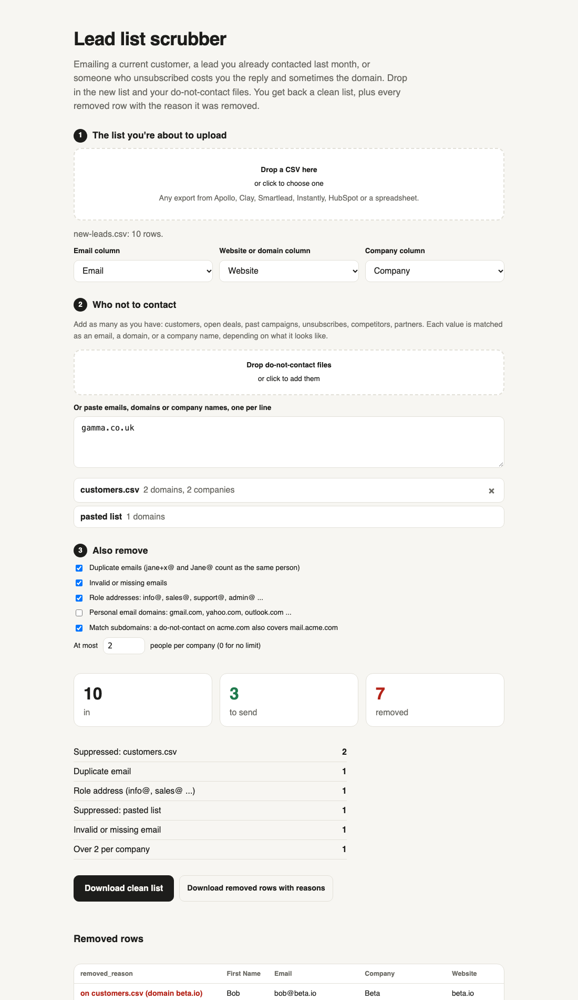

# Lead list scrubber

Before a list goes into your sequencer, take out anyone you shouldn't email:
- current customers and open deals
- people from last month's campaign
- unsubscribes and competitors
- duplicates, info@ addresses, and the eighth person at the same company

You get back a clean list, plus every removed row with the reason it was removed.

**Use it in the browser:** https://trav54219.github.io/lead-list-scrubber/ (neither file leaves your computer)



## How matching works

Add any number of do-not-contact files (CSV or plain text), or paste values in. Each value is matched by its shape:

| Looks like | Matches | Notes |
|---|---|---|
| `jane@acme.com` | that person | Case and plus-addressing are ignored (`Jane+news@ACME.com` is the same person). Gmail dots are ignored. |
| `acme.com` or `https://www.acme.com/about` | everyone at that company | Also covers subdomains like `mail.acme.com`. A whole `co.uk` is never matched. |
| `Acme Holdings, LLC` | that company by name | Matched on the name without Inc, LLC, punctuation or casing. |

In a CSV with a header, the email, website/domain and company columns are found automatically.

Each row is checked in this order, and only the first reason is recorded:
1. invalid or missing email
2. on a do-not-contact list
3. role address (info@, sales@ and the rest)
4. personal email domain (off by default, because some markets sell to owners who use Gmail)
5. duplicate (the first row is kept)
6. over N people per company

## Command line

Needs Node 18 or newer. No dependencies.

```
npx github:Trav54219/lead-list-scrubber leads.csv --dnc customers.csv --dnc unsubscribes.txt --per-company 2 > clean.csv
```

Removed rows with reasons are written to `leads-removed.csv`, and a summary prints to the terminal. Run `node --test` for the tests.

Built by [Travis Heurtelou](https://trav54219.github.io/gtm-engineering-portfolio/). Also: [Domain health](https://trav54219.github.io/domain-health/), [Lead name cleaner](https://trav54219.github.io/lead-name-cleaner/), [Cold email checker](https://trav54219.github.io/cold-email-checker/). MIT license.
